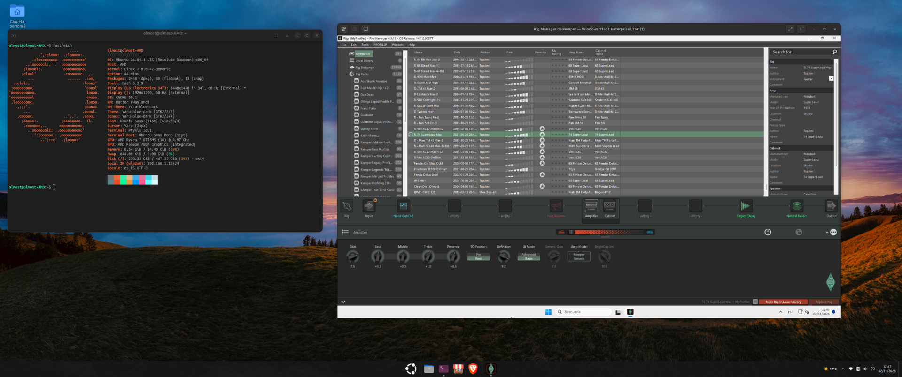

# Rig Manager de Kemper en Linux (dentro de una máquina virtual)

> [Read this in English](README.md)

> ### ⚠️ Aviso: este proyecto se ha escrito con ayuda de inteligencia artificial
>
> Está **probado en máquinas reales** (instalación completa en un Ubuntu limpio y
> otra entera a mano en un Debian con GNOME Boxes), pero una IA también se
> equivoca: **léelo antes de ejecutarlo**, sobre todo la fase 1, que es la única
> que pide permisos de administrador. Sin garantía (licencia MIT). Los detalles
> están en «Cómo se hizo», más abajo.

**Qué es esto:** unos scripts que te montan, en tu propio Linux, una máquina
virtual con Windows 11 IoT Enterprise LTSC y el **Rig Manager** de Kemper
funcionando a pleno rendimiento: control del Profiler, gestión de la biblioteca,
Rig Exchange y **actualización del sistema operativo del Kemper**.

**Por qué una máquina virtual:** el Rig Manager oficial sólo existe para Windows
y macOS. En Linux hay alternativas caseras por MIDI USB, pero no cubren todo
(actualizar el sistema operativo del aparato, por ejemplo). Aquí se usa el
programa oficial, tal cual, con **el Kemper pasado por USB a la máquina virtual**.

**Cómo se usa:** un lanzador en el menú de aplicaciones. Al abrirlo, arranca
Windows, conecta el Kemper y te abre la ventana con Rig Manager. Al cerrarla,
Windows se apaga y **el Kemper vuelve solo a Linux**, donde tu DAW lo vuelve a
ver como siempre.



*El Rig Manager oficial con el Profiler conectado, en una ventana de Windows dentro de Linux. A la izquierda, el escritorio de Linux.*

---

## Aviso importante (léelo, son 20 segundos)

Este repositorio **no incluye ni distribuye**:

- La ISO de Windows 11 IoT Enterprise LTSC 2024 → es de Microsoft.
- El instalador de Rig Manager (`Rig_Manager_*.msi`) → es de Kemper.

**Los aportas tú**, obtenidos por los cauces que te correspondan. Lo que hay aquí
son sólo los scripts que automatizan la instalación en **tu** equipo con **tus**
medios.

Este proyecto **no está afiliado** ni a Kemper GmbH ni a Microsoft. "Kemper",
"Profiler" y "Rig Manager" son marcas de Kemper GmbH; "Windows" lo es de
Microsoft Corporation.

**El icono del proyecto es propio** (ver `icono/`); el icono oficial de Kemper no
se distribuye aquí.

---

## ¿Puede tu PC con esto?

| | |
|---|---|
| Procesador | x86_64 con virtualización (Intel VT-x o AMD-V) |
| Sistema | Linux con **apt** (Debian, Ubuntu, Linux Mint, Pop!_OS…) |
| Memoria | **8 GB o más** (a Windows se le dan 6 GB por defecto) |
| Disco | **30 GB libres** como mínimo |
| Privilegios | Poder usar `sudo` una vez (sólo en el primer paso) |
| Escritorio | Sesión gráfica (el lanzador abre una ventana) |

Comprueba lo tuyo sin cambiar nada:

```bash
./install.sh --comprobar
```

## Lo que necesitas descargar tú

1. **ISO de Windows 11 IoT Enterprise LTSC 2024**, en inglés (`en-us`).
   Es la versión "IoT Enterprise LTSC", no la normal. Es la recomendada: sin
   tienda, sin programas promocionales, sin actualizaciones de funciones
   obligatorias y con soporte hasta 2034.
2. **Rig Manager para Windows** (el `.msi` de la web de Kemper).
3. *(Opcional)* El ISO de **virtio-win** de Fedora. Si no lo tienes,
   `install.sh` lo descarga y lo verifica por ti.

**Qué ISO usar:** la recomendada y probada es **Windows 11 IoT Enterprise LTSC
2024** en inglés. También valen Windows 11 normal (Pro/Home) o Windows 10,
cambiando el nombre de la edición (el instalador te explica cómo) — pero no están
tan probados como la LTSC. Los ajustes regionales del instalador desatendido
están puestos en inglés.

## Instalación (una sola vez)

```bash
git clone https://github.com/granmajestuoso86-sketch/kemper-rigmanager-linux.git
cd kemper-rigmanager-linux
./install.sh
```

`install.sh` te pregunta tres cosas (las rutas de los ficheros de arriba) y
luego hace el resto por fases. **Va paso a paso y puedes parar y seguir donde lo
dejaste** — esto es importante: la instalación de Windows tarda, y si algo se
atasca no hay que empezar de cero.

```bash
./install.sh --estado      # por dónde vas
./install.sh --continuar   # seguir desde donde se quedó
./install.sh --fase 5      # repetir/ejecutar una fase concreta
```

**El instalador tiene idiomas.** Los mensajes se pueden ver en español o inglés
con `KEMPER_LANG=es ./install.sh` (o `KEMPER_LANG=en`), o poniendo `IDIOMA=es`/
`IDIOMA=en` en `config/kemper-vm.conf`. Por defecto usa el idioma del sistema.

**El primer paso** (fase 1) es el único que te pide la contraseña de
administrador: instala los paquetes de virtualización. Después, cuando termine
**cierra sesión y entra de nuevo** (hace falta para que tu usuario entre en el
grupo `libvirt`). Luego sigue con `./install.sh --continuar`.

**El disco de Windows:** el mínimo son **64 GB** (Windows 11 no se instala con
menos) y lo recomendado son **80 GB**, por holgura para actualizaciones y para tus
rigs. Es un disco que crece según se usa: 80 GB no ocupan 80 GB en tu disco.

## Uso diario

Menú de aplicaciones → **Rig Manager (Kemper)**.

1. Se abre Windows y espera a que esté listo (la primera vez, hasta un minuto).
2. **Conecta el Kemper automáticamente**. Da igual el orden: si lo enciendes más
   tarde, un vigilante lo engancha en unos segundos.
3. Rig Manager arranca solo, con tu aparato dentro.
4. **Al terminar, cierra la ventana (la X) y ya está**: Windows se apaga solo y
   el Kemper vuelve a Linux.

> **Lo único que hay que entender de todo esto:** mientras la ventana esté
> abierta, **el Kemper pertenece a Windows**. Tu DAW de Linux no lo verá. No es
> un fallo: un aparato USB tiene un único dueño a la vez. Al cerrar la ventana
> vuelve a ser de Linux.

Si necesitas dejar Windows encendido (por ejemplo, una actualización larga del
sistema operativo del Kemper), no cierres la ventana: minimízala. O usa:

```bash
kemper-rig-manager --dejar-abierto
```

Otros comandos útiles:

```bash
kemper-rig-manager --estado    # qué está pasando ahora mismo
kemper-rig-manager --apagar    # apaga Windows y libera el Kemper
```

## Documentación

- **[manual/GUIA-USUARIO.es.md](manual/GUIA-USUARIO.es.md)** — la guía de uso,
  para quien no sabe Linux (español).
- **[manual/USER-GUIDE.en.md](manual/USER-GUIDE.en.md)** — la misma guía de uso,
  en inglés.
- **[manual/MANUAL-RIG-MANAGER-VM.md](manual/MANUAL-RIG-MANAGER-VM.md)** — el
  manual técnico (52 KB). Explica **por qué** está montado así, las decisiones
  tomadas, las trampas encontradas y las comprobaciones que se hicieron. Es un
  registro de diseño, no un adorno: es la parte que más tiempo ahorra. **Sólo
  está en español**, porque se escribió como registro de trabajo mientras se
  construía el proyecto y traducirlo lo alejaría del código y de la experiencia
  real.

## Si algo va mal

Está todo escrito, con el síntoma tal como lo ves y su arreglo, en la guía de uso
y en el manual:

```
manual/GUIA-USUARIO.es.md         →  §7 "Errores típicos y cómo salir de ellos"
manual/USER-GUIDE.en.md           →  §7 "Typical errors and how to get out of them"
manual/MANUAL-RIG-MANAGER-VM.md   →  §10 "Solución de problemas y trampas"
```

Y si quieres entender **por qué** está montado así (decisiones, trampas
encontradas a base de golpes, y las comprobaciones que se hicieron), ese mismo
manual lo cuenta entero. No es un adorno: es la parte que más tiempo ahorra.

## Estructura del repositorio

```
install.sh                     El instalador. Empieza por aquí.
config/kemper-vm.conf.example  Plantilla de configuración (tus rutas, RAM, disco)
config/vm-domain.xml.in        Plantilla de la máquina virtual
lib/config.sh  lib/config.py   Lectura de la configuración (bash y python)
scripts/                       Las fases, numeradas por orden de ejecución
  ├── 00-setup-root.sh         Paquetes y grupos (el único con sudo)
  ├── 10-build-install-iso.sh  Construye el medio de instalación desatendida
  ├── 20-crear-vm.sh           Disco y definición de la máquina virtual
  ├── 30-instalar-windows.sh   Instala Windows sin intervención
  ├── 40/45-*.sh               Conecta el Kemper (y lo vigila)
  ├── 50-expulsar-isos.sh      Quita los DVD para que arranque del disco
  ├── 70-instalar-lanzador.sh  Icono y entrada en el menú
  ├── kemper-rig-manager       El lanzador
  └── 90-*.py, 95-*.py         Herramientas (verificar, escribir, clics, ficheros)
install/payload/               Scripts que se ejecutan DENTRO de Windows
manual/                        Manual completo de despliegue y uso
docs/                          La captura de la portada (y lo que se añada después)
icono/                         El icono propio del proyecto (el oficial de Kemper no se redistribuye)
```

## Cómo se hizo (y por qué conviene leerlo antes de confiar)

Este repositorio lo ha escrito una **inteligencia artificial**, dirigida y
corregida por una persona. Dicho en claro, para que cada cual decida:

- **Se ha ejecutado, no sólo escrito.** Instalación completa de las siete fases en
  un Ubuntu 24.04 limpio y, después, entera a mano en un Debian dentro de GNOME
  Boxes: Windows instalado y Rig Manager abierto. Los fallos que salieron están
  corregidos y anotados en el manual técnico, con su motivo.
- **Una IA escribe código que parece bien y a veces no lo está.** Varios fallos de
  este proyecto sólo aparecieron al ejecutarlo en un sistema distinto del de
  origen: un mensaje con guiones, un programa que faltaba, una descarga que luego
  no se usaba. Por eso hay una prueba en un segundo sistema, y por eso el
  instalador se puede repetir fase a fase sin romper nada.
- **Léelo antes de ejecutarlo.** Vale para cualquier script que te descargues,
  salga de una IA o no. La única fase que usa `sudo` es la 1, y sólo instala
  paquetes de tu distribución.
- **Sin garantía.** La licencia MIT lo dice: se ofrece tal cual. Si algo se rompe
  en tu equipo, la responsabilidad es tuya. El manual incluye una lista de errores
  típicos y cómo salir de ellos.
- **El paso del Kemper por USB está probado en el equipo de origen**, no en un PC
  virgen ajeno. Es lo único que nadie ha podido verificar en un equipo distinto: si
  lo pruebas en el tuyo, cuéntame cómo ha ido.
- **Si encuentras algo que no cuadra con esta documentación, abre una incidencia.**
  La corrección de alguien que lo ha probado en su equipo vale más que cualquier
  promesa escrita aquí.

## Qué NO hace (y es honesto decirlo)

- **No** te ahorra tener licencia de Windows: sin clave, Windows queda sin
  activar (con marca de agua) y funciona igual.
- **No** incluye los medios de instalación (ver el aviso de arriba).
- **No** está probado fuera de Debian/Ubuntu. En Fedora/Arch habría que adaptar
  los nombres de los paquetes de la fase 1.
- La máquina virtual reserva **6 GB de RAM**: no la dejes abierta mientras uses
  un proyecto enorme de tu DAW.

## Licencia

MIT (ver `LICENSE`). El aviso de marcas, el de medios y el de generación con IA están en `NOTICE`.